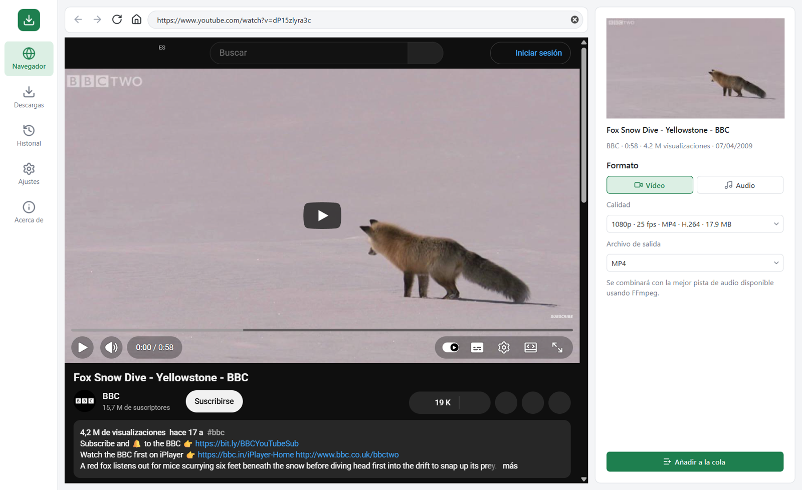
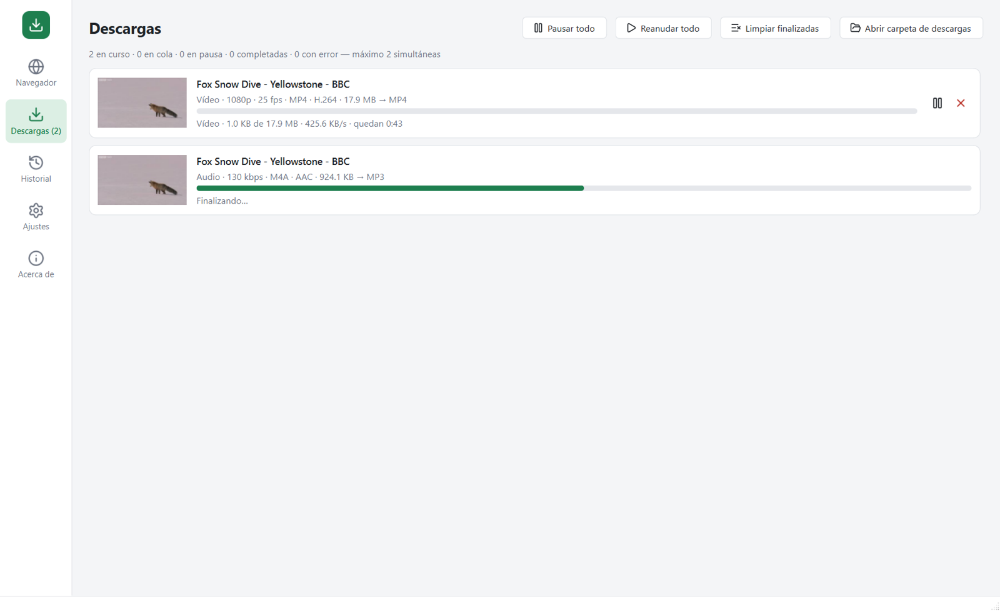

# PyDownload

A desktop YouTube downloader with a built-in, hardened browser and a queued download manager, built with Python, PySide6 (Qt WebEngine) and [yt-dlp](https://github.com/yt-dlp/yt-dlp).
Educational, non-profit project released under the MIT license.

## Features

- **Built-in browser**: browse YouTube inside the app. When you open a video, its URL and metadata (title, channel, duration, views, date, thumbnail) are picked up automatically.
- **Every available format, before queueing**: a side panel lists every video stream (resolution, fps, HDR, codec, container, size) and audio stream (bitrate, codec, size, language).
  - Video in MP4, WEBM or MKV (only containers compatible with the codec are offered), merged with the best matching audio track.
  - Audio as MP3, M4A, Opus, FLAC, WAV or the original stream without conversion.
- **Download manager with a queue**: configurable concurrency (1–5), pause, resume, cancel (partial files are removed), retry, per-download speed limit, progress, speed and remaining time.
- **The UI never blocks**: metadata extraction and downloads run on background threads; progress updates are throttled.
- **History** of completed downloads with "open file" and "show in folder".
- FFmpeg is bundled through `imageio-ffmpeg`; a custom FFmpeg can be set in *Ajustes*.
- Consistent [Lucide](https://lucide.dev) icon set and a light theme that ignores the Windows dark mode.

## Browser security

The embedded browser is treated as untrusted content:

- Navigation is restricted to YouTube and the Google sign-in hosts over HTTPS. Links to other sites are never opened inside the app: you are asked before they open in your default browser. Everything else is blocked.
- Plain HTTP, `file://` and FTP requests are blocked by a request interceptor; certificate errors are always rejected.
- Every permission request (camera, microphone, location, notifications, screen capture, file system, protocol handlers) is denied, and nothing is persisted.
- Browser-initiated downloads, pop-ups, clipboard access, plugins and the PDF viewer are disabled.
- There is no JavaScript bridge: the app never reads data from the page. It only extracts the video ID from the URL (strictly validated) and fetches metadata itself with yt-dlp using a canonical URL, so playlist parameters are ignored and page content cannot inject anything.
- Browser cookies are never shared with yt-dlp. Cookies and cache can be cleared from *Ajustes*.
- Chromium's sandbox stays enabled.

## Requirements

- Python 3.10 or newer.
- Dependencies in `requirements.txt` (`yt-dlp` includes `deno`, which YouTube requires to unlock every format).

## Getting started

```bash
python -m venv env
env\Scripts\activate
pip install -r requirements.txt
cd app
python main.py
```

## Tests

```bash
cd app
python -m unittest discover -s tests
```

## Building the Windows executable

Prebuilt binaries are attached to every [release](https://github.com/caicesardev/PyDownload/releases).
To build one yourself, from an activated virtual environment:

```bash
pip install -r requirements-dev.txt
powershell -ExecutionPolicy Bypass -File build.ps1
```

The script produces `dist/PyDownload/PyDownload.exe` (with Qt WebEngine, FFmpeg and deno bundled) and a zip ready to publish.

## Regenerating resources

Icons are [Lucide](https://lucide.dev) SVGs (ISC license, see `res/icons/lucide/LICENSE`), recolored at runtime. After adding an icon to `res/icons` and listing it in `app/resources.qrc`:

```bash
cd app
pyside6-rcc resources.qrc -o resources_rc.py
```

## Project structure

```
app/
├── main.py                 Entry point
├── constants.py
├── resources.qrc           Icons compiled into resources_rc.py
├── src/
│   ├── browser/            Hardened WebEngine profile, page and navigation policy
│   ├── models/             Formats, metadata, download requests, jobs and history entries
│   ├── pages/              Browser, downloads, history, settings and about pages
│   ├── services/           Download queue, metadata, thumbnails, history, yt-dlp options, URLs
│   ├── settings/           Persistent preferences and application paths
│   ├── utils/              Formatting and file manager helpers
│   ├── widgets/            Sidebar, video panel, download rows, theme
│   ├── windows/            Main window
│   └── workers/            Background threads for metadata and downloads
└── tests/
```

---



---


